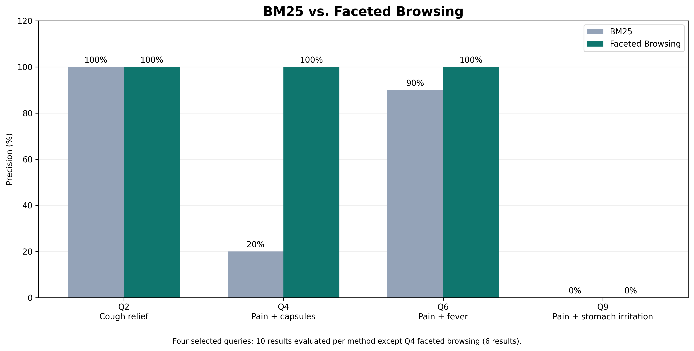

# OTC Medicine Explorer

**A Faceted Information Organization and Retrieval System for Over-the-Counter Medicines**

UC Berkeley | INFO 202 Final Project | Fall 2026

## Live Application

[Launch OTC Medicine Explorer](https://otc-medicine-explorer.streamlit.app/)

## Project Overview

OTC Medicine Explorer is an interactive information organization and retrieval system designed to help users explore a collection of 300 over-the-counter medicines through structured faceted navigation and BM25 keyword retrieval.

The project investigates how human-designed classification systems, machine learning, and text retrieval can complement one another while exposing limitations in information representation.

## Collection

| Attribute | Description |
|---|---|
| Total medicines | 300 |
| Therapeutic groups | 5 |
| Medicines per group | 60 |
| AI-assisted, human-verified reference classifications | 200 |
| Automatically classified medicines | 100 |

## Faceted Taxonomy

| Facet | Classification principle |
|---|---|
| Intended Use | Documented therapeutic purpose |
| Intended User | Documented intended population |
| Dosage Form | Standardized formulation family |
| Brand Type | Brand classification |
| Documented Safety Risk | Explicit adverse outcomes in selected warning texts |

The invented facet, Documented Safety Risk, organizes adverse outcomes into nine categories, including residual categories for other documented risks and unspecified risks.

The browser also supports filtering by therapeutic group and classification provenance.

## System Features

- Interactive multi-facet filtering.
- BM25 keyword search.
- Combined keyword search and faceted navigation.
- Dynamic result counts and distribution visualizations.
- Product-level uses and selected warnings.
- Transparent classification provenance.
- Pagination and filter reset.

The interface applies OR logic within facets and AND logic across different facets.

## System Architecture

```text
Raw OTC Medicine Dataset
          |
Data Cleaning and Standardization
          |
Faceted Taxonomy and Safety Risk Codebook
          |
Stratified Reference Sample (200)
          |
TF-IDF + Logistic Regression
          |
Automatic Classification (100)
          |
Final Classified Collection (300)
          |
    Streamlit Application
       /           \
Faceted Browsing   BM25 Retrieval
       \           /
    Retrieval Evaluation
```

## Automatic Classification

The Documented Safety Risk facet was extended to the remaining 100 medicines using multi-label classification with TF-IDF features and one-vs-rest logistic regression.

A grouped train-test split was used to prevent identical normalized warning texts from appearing in both training and testing sets.

### Classification Performance

| Metric | Baseline | Model |
|---|---:|---:|
| Micro-F1 | 40.00% | 89.89% |
| Exact-match accuracy | 44.44% | 83.33% |
| Hamming loss | 14.81% | 2.78% |

The held-out evaluation included 36 medicines. The final model was subsequently trained on all 200 reference-classified medicines.

## Information Retrieval Evaluation

Ten information needs were evaluated using binary relevance judgments and Precision@10.

| BM25 Implementation | Mean Precision@10 |
|---|---:|
| Original experimental implementation | 51% |
| Browser implementation | 48% |

### BM25 versus Faceted Browsing

| Information Need | BM25 P@10 | Faceted Precision |
|---|---:|---:|
| Cough relief | 100% | 100% |
| Pain relief in capsules | 20% | 100% |
| Pain and fever | 90% | 100% |
| Pain and stomach irritation | 0% | 0% |
| Mean across four queries | 52.5% | 75% |

The comparison is exploratory. Faceted precision uses the first ten displayed results, except for the capsule query, which returned six products.



### Boolean Logic Investigation

| Information Need | OR Results | AND Results |
|---|---:|---:|
| Pain and fever | 68 | 63 |
| Pain and upset stomach | 71 | 0 |

These experiments demonstrate that interface logic, taxonomy coverage, and collection composition influence retrieval effectiveness.

## Repository Organization

```text
otc-medicine-explorer/
|
|-- app.py
|-- requirements.txt
|-- OTC_Final_Classified_300.csv
|-- README.md
|
|-- data/
|   Raw and standardized datasets
|
|-- docs/
|   Faceted taxonomy, codebook and data dictionary
|
|-- notebooks/
|   Data preparation, facet development,
|   automatic classification and browser development
|
|-- classification/
|   Reference labels and machine predictions
|
|-- evaluation/
|   Classification metrics, held-out predictions,
|   learned features and error analysis
|
|-- retrieval/
|   Search queries, relevance judgments,
|   retrieval experiments and visualizations
```

## Documentation

- [Faceted Taxonomy](docs/Faceted_Taxonomy.md)
- [Safety Risk Codebook](docs/Safety_Risk_Codebook.md)
- [Data Dictionary](docs/Data_Dictionary.md)
- [Data Documentation](data/README.md)
- [Development Notebooks](notebooks/README.md)
- [Classification Documentation](classification/README.md)
- [Classification Evaluation](evaluation/README.md)
- [Retrieval Evaluation](retrieval/README.md)

## Technology Stack

- Python
- Pandas and NumPy
- Scikit-learn
- TF-IDF and Logistic Regression
- Rank-BM25
- Streamlit
- Google Colab
- GitHub
- Streamlit Community Cloud

## Run Locally

Clone the repository:

```bash
git clone https://github.com/minjshayanti/otc-medicine-explorer.git
cd otc-medicine-explorer
```

Install dependencies:

```bash
pip install -r requirements.txt
```

Launch the application:

```bash
streamlit run app.py
```

## Limitations and Ethical Considerations

- The collection is not representative of the entire OTC medicine market.
- Selected warning texts do not capture every documented medication risk.
- Risk Not Specified indicates missing explicit adverse-outcome information, not medication safety.
- Reference classifications were AI-assisted and human-verified.
- Machine-generated classifications may contain errors.
- One risk category had no positive reference examples and could not be learned.
- Classification performance is based on a small held-out sample.
- The retrieval comparison uses a limited number of information needs.
- Additional BM25 relevance judgments underwent AI-assisted consistency review and human approval.
- The taxonomy reflects classificatory decisions that may privilege some information needs while obscuring others.

This application is an educational information organization and retrieval system. It is not intended to provide medical advice, establish medication safety, or recommend treatment.

## Author

Shayanti Minj

Master of Information Management and Systems

UC Berkeley School of Information
